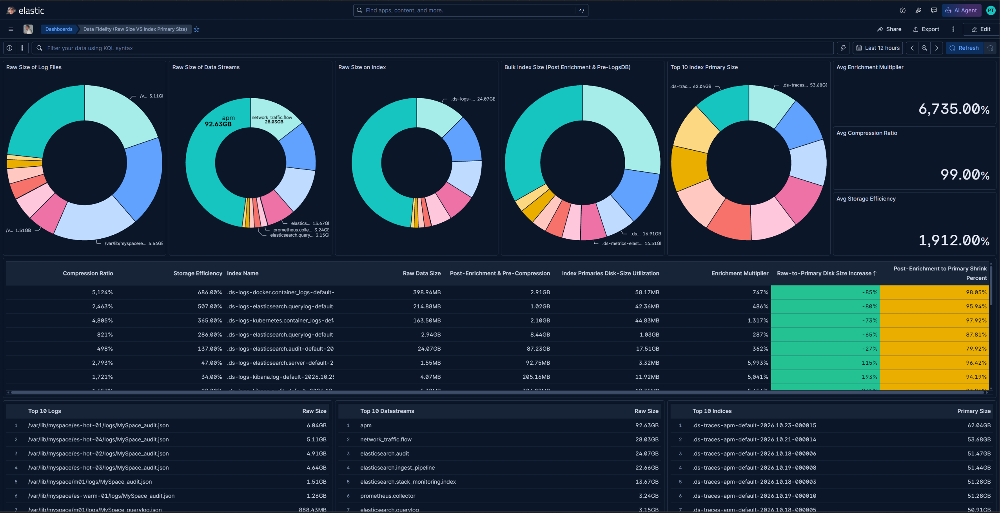

# Raw Data Size

Measure how big your data was **before** Elasticsearch touched it, and compare that with what it costs on disk.

An ingest pipeline stamps every document with `raw.size`, a transform keeps the latest per-index store and bulk sizes from Stack Monitoring in a lookup index, and a Kibana dashboard joins the two with ES|QL to show enrichment overhead, compression, and storage efficiency per index.

```
 source event ──► event_original_size pipeline ──► raw.size on every doc ─────────┐
                                                                              ├─► ES|QL LOOKUP JOIN ─► dashboard
 Stack Monitoring index metrics ──► transform ──► monitoring-latest-lookup ───┘
```



## What's in here

| Path | What it is |
| --- | --- |
| `ingest-pipeline/event_original_size.json` | Ingest pipeline that sets `raw.size` |
| `component-template/logs@custom.json` | Maps `raw.size` as `long` and makes the pipeline the default for `logs-*-*` data streams |
| `transform/monitoring-latest-lookup.index.json` | Destination index for the transform, created in `lookup` mode |
| `transform/monitoring_index_latest.json` | Continuous transform: latest primary store size and bulk size per index |
| `kibana/data-fidelity-dashboard.ndjson` | Dashboard "Data Fidelity (Raw Size VS Index Primary Size)" with its Lens panels, data views and tag |
| `images/data-fidelity-dashboard.png` | Screenshot of the dashboard |
| `setup.sh` | Installs all of the above with `curl` |

## Requirements

- Elasticsearch and Kibana 9.x. The dashboard uses ES|QL `LOOKUP JOIN`, and a saved-object export can't be imported into a Kibana older than the one it came from.
- Elasticsearch Stack Monitoring collected by Elastic Agent (the Elasticsearch integration), so that `metrics-elasticsearch.stack_monitoring.index-default` exists and carries `elasticsearch.index.primaries.store.size_in_bytes` and `elasticsearch.index.total.bulk.total_size_in_bytes`.
- Privileges to manage ingest pipelines, transforms, indices and Kibana saved objects.

## How raw size is calculated

The pipeline is four Painless script processors, tried in order, each with `ignore_failure: true`:

| Order | Source | When it applies |
| --- | --- | --- |
| 1 | `event.original` | The original event was preserved |
| 2 | `message` | `raw.size` isn't set yet and `message` exists |
| 3 | `query` | No `message`-based size and `query` exists |
| 4 | whole document (`ctx.toString()`) | None of the above fields exist |

`raw.size` is the string **length in characters**, not encoded bytes. For ASCII logs the two are equal; multi-byte UTF-8 content is undercounted.

## Install

### Script

```bash
ES_URL=https://<elasticsearch>:9200 \
KIBANA_URL=https://<kibana>:5601 \
API_KEY=<encoded api key> \
./setup.sh
```

### By hand

1. **Pipeline** — Dev Tools:

   ```
   PUT _ingest/pipeline/event_original_size
   { ...contents of ingest-pipeline/event_original_size.json... }
   ```

2. **Lookup index** — create it *before* the transform. If the transform creates it, it won't be in `lookup` mode and the dashboard's `LOOKUP JOIN` fails.

   ```
   PUT monitoring-latest-lookup
   { ...contents of transform/monitoring-latest-lookup.index.json... }
   ```

3. **Transform**

   ```
   PUT _transform/monitoring_index_latest
   { ...contents of transform/monitoring_index_latest.json... }

   POST _transform/monitoring_index_latest/_start
   ```

4. **Component template** — see [Attach the pipeline to your data](#attach-the-pipeline-to-your-data).

5. **Dashboard** — Kibana → Stack Management → Saved Objects → Import → `kibana/data-fidelity-dashboard.ndjson`.

### Attach the pipeline to your data

The pipeline does nothing until documents pass through it. `component-template/logs@custom.json` wires it into every `logs-*-*` data stream:

```
PUT _component_template/logs@custom
{ ...contents of component-template/logs@custom.json... }
```

It does four things:

- maps `raw.size` as `long`
- sets `index.default_pipeline` to `event_original_size`
- sets `index.mode` to `logsdb` and enables the data stream lifecycle
- maps `client.zone`, `server.zone`, `source.zone` and `destination.zone` as `keyword`

Before you apply it:

- **It replaces any existing `logs@custom`.** If you already have one, merge the two. `setup.sh` skips this step when one exists.
- **It takes effect at the next rollover.** Roll a data stream over (`POST logs-myapp-default/_rollover`) to pick it up straight away.
- **Check data streams that already have a default pipeline.** A data stream whose template sets its own `index.default_pipeline` (integration data streams do) can end up with this one instead, skipping its normal parsing. For those, call `event_original_size` from the data stream's own `@custom` ingest pipeline instead:

  ```
  PUT _ingest/pipeline/logs-<dataset>@custom
  {
    "processors": [
      { "pipeline": { "name": "event_original_size", "ignore_missing_pipeline": true } }
    ]
  }
  ```

For indices outside `logs-*-*`, set `index.default_pipeline` or `index.final_pipeline` to `event_original_size` on the index or its template.

## The dashboard

Time range defaults to the last 12 hours. Data comes from the `O11Y` data view (`traces-*,logs-*,metrics-*,apm-*,profiling*`) and the `ES Stack Monitoring` data view.

| Panel | Shows |
| --- | --- |
| Raw Size of Log Files / Data Streams / on Index | `SUM(raw.size)` by `log.file.path`, `data_stream.dataset`, `_index` |
| Bulk Index Size (Post Enrichment & Pre-LogsDB) | Latest `bulk.total_size_in_bytes` per index |
| Top 10 Index Primary Size | Latest `primaries.store.size_in_bytes` per index |
| Avg Enrichment Multiplier / Compression Ratio / Storage Efficiency | Averages of the per-index ratios below |
| Per-index table | All three sizes and every ratio, per index |
| Top 10 Log Files / Data Streams / Indices by Primary Size | Ranked tables |

Per-index metrics, where *raw* = `SUM(raw.size)`, *bulk* = `total.bulk.total_size_in_bytes`, *primary* = `primaries.store.size_in_bytes`:

| Metric | Formula | Reads as |
| --- | --- | --- |
| Enrichment Multiplier | bulk / raw | How much parsing and enrichment grew the data before it was stored |
| Compression Ratio | bulk / primary | How much the index (codec, LogsDB, synthetic source) shrank what was sent |
| Storage Efficiency | raw / primary | Raw bytes represented per byte on disk; above 100% means the index is smaller than the raw data |
| Raw-to-Primary Disk Size Increase | (primary − raw) / raw | Net growth (positive) or saving (negative) against raw |
| Post-Enrichment to Primary Shrink Percent | (bulk − primary) / bulk | Share of the enriched payload removed by storage |

The ES|QL panels only count documents that have both `raw.size` and `log.file.path`.

## Reading the numbers

- **Time range matters.** Raw size is summed over the dashboard's time range, while bulk and primary sizes are the index's latest totals. The ratios are only meaningful when the time range covers everything in the index.
- **Bulk size is a counter.** `bulk.total_size_in_bytes` is tracked by the nodes holding the shards, so it can reset after a node restart or shard relocation.
- **Primary size moves.** Merges and force-merges change store size after the data arrives; young indices look worse than they'll end up.
- **Only documents ingested after the pipeline is attached have `raw.size`.** Indices with a mix of old and new documents understate raw size.
